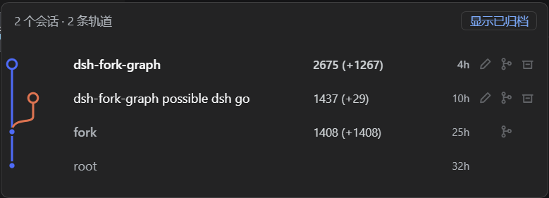

# dsh-fork-graph

A git-style fork graph for DeepSeek Harness conversations, inline in the conversation header.

Every conversation gets one header button. It opens a popover with the lane graph of the whole
session tree that conversation belongs to: colored lanes, hollow circles for conversation heads,
solid dots for fork points, and a virtual `root` row at the bottom. Click a row — or the lane area
at that row's height — to open the conversation. Each row also carries rename / fork / archive
actions.

[中文说明](README.zh.md) · [Lifecycle notes](docs/lifecycle.md) (Chinese)



## What it does

- **The tree of the current conversation only.** A single-session tree still opens and draws
  `root` + itself.
- **Fork points are conversation positions.** Two sessions that fork with the same amount of
  conversation are one split even when bookkeeping events (`turn/*`, `job/*`, `delivery-*`) differ.
- **Fork from a fork point.** The fork action on a fork row calls the native fork with an exact
  event boundary, so the new conversation starts at that point instead of the source's current head.
- **Rename / archive** use the same native calls as the session list. Archiving a running session
  asks first, then stops and archives it.
- **Archived sessions** can be hidden with a header toggle. Columns dim to 55% while visible. A
  conversation that is itself archived always shows the full tree — the toggle is locked to
  “includes archived”.
- **Live status** comes from the client's own session status: a spinner while a conversation runs,
  a blue dot for a completion you have not opened yet. Without the status hook the cell shows a red
  ✕ explaining why.
- **Localization** follows the DSH language setting (zh / en dictionaries are registered through
  `ctx.locale`).
- **Theming** uses the `--dsw-alias-*` design tokens, so light and dark both work.

## How it works

The browser cannot see event bodies, and lineage is a property of the event logs — a fork copies an
exact prefix of its source log. So the plugin has two halves:

| Half | File | Job |
|---|---|---|
| Host | `index.js` | reads session logs, computes lineage and layout, publishes JSON on `/plugins/dsh-fork-graph/lineage.json` (plus a rebuild route) |
| Client | `client.js` | draws the published layout, handles navigation and actions — no analysis |

The Host reuses a per-file parse cache on disk (`$DSH_HOME/storages/fork-graph-cache.json`), so a
restart only parses what changed. See [docs/lifecycle.md](docs/lifecycle.md) for every refresh
trigger and the full build pipeline.

## Install

Requires DeepSeek Harness 0.2.x with the desktop or web client.

1. Install the directory as a bundle — **Plugins → Add plugin → local directory**, or
   `plugin_manager install_bundle` with the absolute path of this repository.
2. Restart DSH once so the Host half registers its routes.

The package is a local bundle, not an npm library: it is linked into the profile by the plugin
manager.

## Verify

- every conversation shows the header button; a single-session tree draws `root` + itself
- a fork point row shows a solid dot and a forking source; its fork action creates a conversation
  that starts at that point
- archiving (from this panel or from the native menu) updates the graph within a second or two
- switching the DSH language switches the panel copy

## Development

The tools run under the Electron binary that ships with DSH:

```powershell
$env:ELECTRON_RUN_AS_NODE='1'

& $env:DSH_NODE_EXECUTABLE --check index.js
& $env:DSH_NODE_EXECUTABLE --check client.js

& $env:DSH_NODE_EXECUTABLE tools\check.mjs          # host routes + render smoke test + i18n parity
& $env:DSH_NODE_EXECUTABLE tools\check-archive.mjs  # archive changes reach the warm rebuild
& $env:DSH_NODE_EXECUTABLE tools\timing.mjs         # boot / first build / warm rebuild
& $env:DSH_NODE_EXECUTABLE tools\bench.mjs 2000     # scaling with 2000 synthetic logs
```

For a payload-level regression, snapshot the same input twice and diff it:

```powershell
& $env:DSH_NODE_EXECUTABLE tools\snapshot.mjs before.json --home <fixture>
# change the code
& $env:DSH_NODE_EXECUTABLE tools\snapshot.mjs after.json --home <fixture>
& $env:DSH_NODE_EXECUTABLE tools\diff-payload.mjs before.json after.json
```

`DSH_FORK_GRAPH_DEBUG=1` makes the Host print per-phase timings; `lib/assets/build-stats.json`
always records the first build after a restart and the last ten builds (trigger + timings).

## Limitations

- Lineage is derived from the session log layout (`$DSH_HOME/sessions/*/*/session*.jsonl.zstd`) and
  the archive set (`$DSH_HOME/storages/workspace.json`); a DSH release that changes either needs a
  follow-up.
- A cold start (first install, or many changed logs) parses everything once — a few seconds in the
  background, never on the boot path.
- Fork points and the `root` row are not clickable; they have no conversation of their own.
- The lane palette is fixed so branches keep their colour across themes.

## Credits

The idea of putting a fork graph into the conversation header — and the overall shape of the graph —
comes from [chouyong/dsh-fork-graph](https://github.com/chouyong/dsh-fork-graph). This plugin is an
independent implementation: the Host half derives the lineage itself from the session logs (shared
event prefixes, content-based fork positions), and the client adds the lane layout, per-row actions
and the archived toggle. Thanks to the upstream author for the inspiration.

## License

[MIT](LICENSE)
